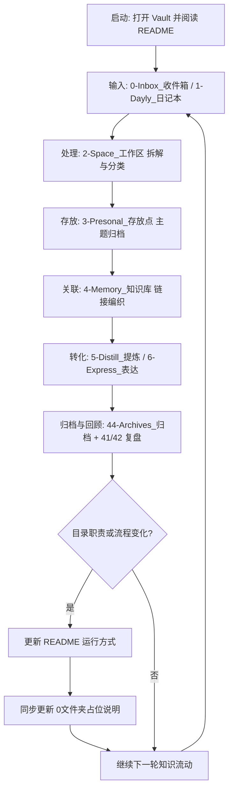

#obsidian #知识库/理论 
> [!summary] 库类型
> 1. 个人库部分 # 同步 # 移动 # 按照核心需求自定义
> 2. 知识库部分 # 源控  # 理论
> 3. 项目库种类 # 智能体
# 仓库目录
## 占位
- [[0文件夹：0-Inbox_收件箱]]
- [[0文件夹：1-Dayly_日记本]]
- [[0文件夹：11-Journals_日历]]
- [[0文件夹：12-TimeLine_时间线]]
- [[0文件夹：2-Space_工作区]]
- [[0文件夹：21-Work_工作流]]
- [[0文件夹：22-Flow_心流]]
- [[0文件夹：23-Note_备忘]]
- [[0文件夹：3-Presonal_存放点]]
- [[0文件夹：31-JUWEN_钜文]]
- [[0文件夹：32-Learning_学习]]
- [[0文件夹：33-ToDo_策略]]
- [[0文件夹：34-Relax_娱乐]]
- [[0文件夹：35-Social_社会]]
- [[0文件夹：36-Life_生活]]
- [[0文件夹：37-Profiles_隐私]]
- [[0文件夹：4-Memory_知识库]]
- [[0文件夹：41-Projects_项目]]
- [[0文件夹：41-a-job_工作]]
- [[0文件夹：41-b-system_系统知识]]
- [[0文件夹：42-Areas_领域]]
- [[0文件夹：43-Resources_资源]]
- [[0文件夹：43-a-SyncPush_移动推送]]
- [[0文件夹：43-b-TabGroup_选项卡组]]
- [[0文件夹：44-Archives_归档]]
- [[0文件夹：44-a-raw_原始素材]]
- [[0文件夹：44-b-Mooniy_月档案]]
- [[0文件夹：44-c-Done_闭环]]
- [[0文件夹：5-Distill_提炼]]
- [[0文件夹：51-Cards_卡片]]
- [[0文件夹：52-Examples_示例]]
- [[0文件夹：53-Wisdom_智慧]]
- [[0文件夹：6-Express_表达]]
- [[0文件夹：61-Wiki_个人维基]]
- [[0文件夹：62-Chat_会话记录]]
- [[0文件夹：Attachments]]
- [[0文件夹：Files]]
- [[0文件夹：Docx]]
- [[0文件夹：Images]]
- [[0文件夹：PDFs]]
- [[0文件夹：LFS]]
- [[0文件夹：Audios]]
- [[0文件夹：Videos]]
- [[0文件夹：Bases]]
- [[0文件夹：Diff]]
- [[0文件夹：Templates]]

^034c2e

## 树视图
```text
lgx
├── .git
├── .github
├── .obsidian
├── 0-Inbox_收件箱
├── 1-Dayly_日记本
│   ├── 11-Journals_日历
│   └── 12-TimeLine_时间线
├── 2-Space_工作区
│   ├── 21-Work_工作流
│   ├── 22-Flow_心流
│   └── 23-Note_备忘
├── 3-Presonal_存放点
│   ├── 31-JUWEN_钜文
│   ├── 32-Learning_学习
│   ├── 33-ToDo_策略
│   ├── 34-Relax_娱乐
│   ├── 35-Social_社会
│   ├── 36-Life_生活
│   └── 37-Profiles_隐私
├── 4-Memory_知识库
│   ├── 41-Projects_项目
│   │   ├── 41-a-job_工作
│   │   └── 41-b-system_系统知识
│   ├── 42-Areas_领域
│   ├── 43-Resources_资源
│   │   ├── 43-a-SyncPush_移动推送
│   │   │   ├── 43-a1-bili_哔哩哔哩
│   │   │   ├── 43-a2_douyin_抖音
│   │   │   └── 43-a3_wechat_微信
│   │   └── 43-b-TabGroup_选项卡组
│   └── 44-Archives_归档
│       ├── 44-a-raw_原始素材
│       ├── 44-b-Mooniy_月档案
│       │   └── 2026-07~2026-08
│       └── 44-c-Done_闭环
├── 5-Distill_提炼
│   ├── 51-Cards_卡片
│   ├── 52-Examples_示例
│   └── 53-Wisdom_智慧
├── 6-Express_表达
│   ├── 61-Wiki_个人维基
│   └── 62-Chat_会话记录
├── Attachments
│   ├── Files
│   │   ├── Docx
│   │   ├── Images
│   │   └── PDFs
│   └── LFS
│       ├── Audios
│       └── Videos
├── Bases
├── Diff
└── Templates
```

^1e138e

# 仓库结构
[[主题：obsidian仓库构建#理念]][^1]
## 仓库功能
1. 输入（断点/推送/传输/日记/吸收）：`0-Inbox_收件箱`/ `1-Dayly_日记本`
2. 处理（工作区/分解任务）：`2-Space_工作区`
3. 存放（存放点/分类）：`3-Presonal_存放点`
4. 关联（知识库/编织区）：`4-Memory_知识库`
5. 转化（agent协助）：`5-Distill_提炼`/`6-Express_表达`
## 个人需求
1. 日记/灵感/模版： `12-TimeLine_时间线`/`0-Inbox_收件箱`/`Templates`
2. 社会/对立：`35-Social_社会`
3. 学习/知识：`32-Learning_学习`/`33-ToDo_策略`
4. 工作/策略：`31-JUWEN_钜文`
5. 娱乐/游戏：`34-Relax_娱乐`
6. 生活/消费：`36-Life_生活`
7. 个人/隐私：`37-Profiles_隐私`
## GTD映射
1. Capture：`0-Inbox_收件箱`
2. Process：`1-Dayly_日记本`
3. Organize：`2-Space_工作区`
4. Review：`3-Presonal_存放点`
5. Do：`4-Memory_知识库`
## CODE映射
1. C：`0-Inbox_缓存区`/`1-Dayly_日记本`
2. O：`4-Memory_知识库`
3. D：`5-Distill_提炼`
4. E：`6-Express_表达`
## PARA映射
1. P：`41-Projects_项目`
2. A：`42-Areas_领域`
3. R：`43-Resources_资源`
4. A：`44-Archives_归档`
## 卡片盒映射
1. 闪念笔记：`1-Dayly_日记本`
2. 文献笔记：`43-Resources_资源`
3. 永久笔记：`51-Cards_卡片`
4. 索引笔记：`41-Projects_项目`/`42-Areas_领域`
## DIKW映射
1. 数据（Data）：`1-Dayly_日记本`
2. 信息（Information）：`3-Presonal_存放点`
3. 知识（Knowledge）：`4-Memory_知识库`
4. 智慧（Wisdom）：`53-Wisdom_智慧`
## LLM映射
1. raw：`44-a-raw_原始素材`/`Templates`
2. wiki：`61-Wiki_个人维基`
3. prompt：`AGENTS`/`README`
4. chat： `62-Chat_会话记录`
## 其他
- 组织方式
	1. 按时间： `1-Dayly_日记本` 
	2. 按任务：`2-Space_工作区`
	3. 按主题：`3-Presonal_存放点`
	4. 打标签：`4-Memory_知识库`
- 文件夹作用
	1. 分类：`3-Presonal_存放点`
	2. 区分行动状态：根目录从上到下
- 标签作用
	1. 关联分支：`4-Memory_知识库`
	2. 情景分类：`情绪` `评价`
	3. 状态标记：`状态` 

# 个人知识库
## 运行方式
- 启动方式
	1. 使用 Obsidian 打开仓库根目录 `lgx` 作为 Vault。
	2. 首次进入后优先查看本文件，确认目录分层与映射关系（GTD / PARA / CODE / DIKW）。
	3. 日常记录从 `0-Inbox_收件箱` 与 `1-Dayly_日记本` 开始，不直接跳到知识层。
- 日常流转（建议默认路径）
	1. **输入**：临时想法、外部素材先进入 `0-Inbox_收件箱`。  
	2. **处理**：在 `2-Space_工作区` 完成拆解、清洗与分类判断。  
	3. **存放**：将可保留内容放入 `3-Presonal_存放点` 对应主题目录。  
	4. **关联**：把稳定知识沉淀到 `4-Memory_知识库`，建立链接与索引。  
	5. **转化**：在 `5-Distill_提炼` 形成卡片，在 `6-Express_表达` 输出为 wiki / 会话记录。  
- 时间线与归档
	1. 时间记录集中在 `12-TimeLine_时间线`，按日期维护日记与月记。
	2. 当月结束后，将阶段性材料迁入 `44-Archives_归档`（raw / 月档案 / done）。
	3. 固定回顾入口：`41-Projects_项目`（项目维度）与 `42-Areas_领域`（长期维度）。
- 协作与版本管理
	1. 本仓库为个人库，仅使用 Git 进行定时备份

## 示意图


[^1]:  待处理：
	移动：日常/对立/策略/知识/游戏/收藏
	吸收：git体系/gitbash命令行/vscode容器/work工作规划/vibecoding知识树
